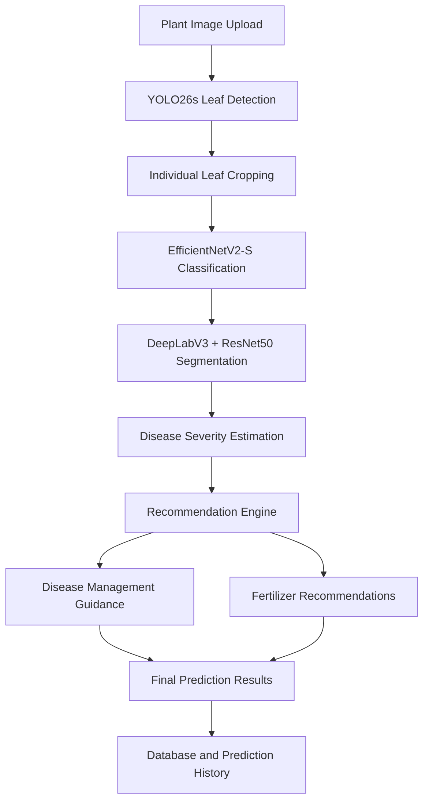

# 🌱 AgriVisionAI – AI-Powered Agricultural Intelligence Platform

AgriVisionAI is a full-stack agricultural intelligence platform that combines deep learning, computer vision, and web technologies to help farmers analyze plant health, identify crop diseases, estimate disease severity, and receive agricultural recommendations.

The platform integrates multiple AI models with farmer profiles, prediction history, weather information, and agricultural market price data to provide a unified farming support application.

---

## 🚀 Key Features

### 🤖 AI-Powered Plant Disease Detection
- Detects individual leaves from uploaded plant images.
- Identifies crop types and plant diseases across 98 disease classes.
- Processes multiple leaves within a single image.
- Provides disease classification confidence scores.

### 🌿 Disease Severity Analysis
- Uses semantic segmentation to estimate affected leaf areas.
- Calculates the estimated percentage of diseased pixels.
- Categorizes disease severity into:
  - Mild
  - Moderate
  - Severe

### 🧪 Intelligent Agricultural Recommendations
- Generates disease-management recommendations based on detected diseases.
- Provides crop-specific general guidance.
- Suggests fertilizer options and nutrient focus.
- Supports optional soil NPK and pH information.
- Includes fertilizer purchase links.

### 👨‍🌾 Farmer Dashboard and Profiles
- User registration and login.
- Email OTP verification during login.
- Farmer profile management.
- Stores agricultural information such as crop type, farm size, soil type, and location.
- Maintains individual prediction history.

### 🌦️ Weather Information
- Retrieves weather information using the OpenWeather API.
- Supports browser-provided location coordinates.
- Can use the farmer's saved district or state as a location fallback.

### 📊 Agricultural Market Prices
- Integrates CEDA Agmarknet APIs.
- Retrieves agricultural commodities and geographical information.
- Supports market selection and price retrieval.

### ⚙️ Additional Features
- Language preference settings.
- Government schemes page.
- AI chatbot interface.
- Contact form with email integration.

---

## 🧠 AI Architecture

AgriVisionAI uses three deep-learning models connected through a sequential inference pipeline.

| Model | Purpose |
|---|---|
| YOLO26s | Individual leaf detection |
| EfficientNetV2-S | Crop disease classification |
| DeepLabV3 with ResNet50 | Diseased-region segmentation |

### AI Processing Workflow

1. **Image Input:** The user uploads a plant image.
2. **Leaf Detection:** YOLO26s identifies individual leaves and their bounding boxes.
3. **Disease Classification:** Each detected leaf is cropped and passed to EfficientNetV2-S for classification into one of 98 classes.
4. **Severity Estimation:** DeepLabV3 generates a segmentation output used to estimate the diseased pixel percentage.
5. **Recommendation Generation:** A rule-based recommendation engine generates disease-management and fertilizer guidance.
6. **Result Storage:** Prediction results are stored in the database and displayed to the user.

### Architecture Diagram



---

## 🛠️ Technology Stack

### Backend
- Python
- Flask
- Flask-SQLAlchemy
- Flask-Bcrypt
- Flask-Mail

### Artificial Intelligence and Deep Learning
- PyTorch
- Torchvision
- Ultralytics YOLO
- EfficientNetV2-S
- DeepLabV3
- ResNet50
- Pillow

### Frontend
- HTML5
- CSS3
- JavaScript
- Jinja2 Templates

### Database
- SQLAlchemy ORM

### External APIs
- OpenWeather API
- CEDA Agmarknet API

---

## 📂 Project Structure

```text
AgriVisionAI/
│
├── ai_models/
│   └── disease_models/
│       └── class_mapping.json
│
├── backend/
│   ├── database/
│   │   ├── db.py
│   │   └── models.py
│   │
│   ├── routes/
│   ├── services/
│   ├── utils/
│   │
│   ├── ai_service.py
│   ├── app.py
│   ├── config.py
│   ├── email_service.py
│   ├── extensions.py
│   └── otp_utils.py
│
├── docs/
│
├── frontend/
│   ├── static/
│   │   ├── css/
│   │   ├── images/
│   │   └── js/
│   │
│   └── templates/
│       ├── components/
│       ├── dashboard.html
│       ├── history.html
│       ├── home.html
│       ├── login.html
│       ├── market.html
│       ├── prediction.html
│       ├── profile.html
│       ├── register.html
│       ├── scan.html
│       ├── verify_otp.html
│       └── weather.html
│
├── scripts/
├── test_images/
│
├── ai_pipeline.py
├── recommendation_engine.py
├── requirements.txt
└── README.md
```

---

## ⚙️ Installation and Setup

### 1. Clone the Repository

```bash
git clone https://github.com/sakethnadide-a11y/AgriVisionAI.git

cd AgriVisionAI
```

### 2. Create a Virtual Environment

```bash
python -m venv venv
```

Activate it:

**Windows:**
```bash
venv\Scripts\activate
```

**Linux / macOS:**
```bash
source venv/bin/activate
```

### 3. Install Dependencies

```bash
pip install -r requirements.txt
```

### 4. Configure Environment Variables

Configure the application settings using the provided `.env.example` and backend configuration.

The application requires appropriate configuration for:

- Flask secret key.
- Database connection.
- Email credentials for OTP verification.
- OpenWeather API key.
- CEDA API key.

Never commit actual passwords, API keys, email credentials, or other secrets to GitHub.

### 5. Configure Trained AI Models

The complete AI pipeline requires three trained model-weight files.

Place them in the following locations:

```text
ai_models/
│
├── leaf_detector/
│   └── AgriVisionAI_YOLO26s_PlantDoc_best.pt
│
├── disease_models/
│   ├── best_efficientnetv2s.pth
│   └── class_mapping.json
│
└── severity_model/
    └── best_severity_model.pth
```

**Important:** The trained `.pt` and `.pth` model weights are not currently included in this GitHub repository. Obtain the corresponding files separately and place them in the specified directories before running AI inference.

### 6. Run the Application

From the project root:

```bash
cd backend
python app.py
```

Open the local address displayed by Flask in your terminal.

---

## 📊 Database Design

The application uses three primary database models:

| Model | Purpose |
|---|---|
| User | Stores account and authentication information |
| FarmerProfile | Stores farmer and agricultural profile information |
| Prediction | Stores AI prediction results and recommendations |

Prediction records include crop information, disease classification, confidence scores, estimated diseased area, severity, and fertilizer recommendations.

---

## 🔮 Future Improvements

- Improve disease classification and segmentation performance.
- Expand crop and disease coverage.
- Integrate more comprehensive soil analysis.
- Improve personalized agricultural recommendations.
- Expand multilingual support.
- Improve deployment and model-serving infrastructure.
- Add further agricultural data integrations.

---

## ⚠️ Disclaimer

AgriVisionAI is an experimental agricultural decision-support platform.

AI-generated disease classifications and severity estimates are not a substitute for professional agricultural diagnosis. Fertilizer and disease-management recommendations are general guidance and should be validated against soil-test results, product instructions, and local agricultural advice.

---

## 👨‍💻 Author

**Saketh Nadide**

GitHub: [@sakethnadide-a11y](https://github.com/sakethnadide-a11y)

Project: [AgriVisionAI](https://github.com/sakethnadide-a11y/AgriVisionAI)

---

⭐ If you find this project interesting, consider giving the repository a star!
